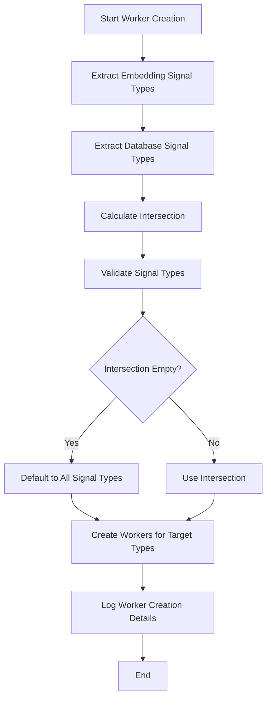

# Smart Worker Creation Optimization

## Overview

This document describes the implementation of **Smart Worker Creation** - an optimization that reduces resource usage by creating embedding workers only for signal types that are actually targeted by both the embedding filter and database filter configurations.

## Problem Statement

### Previous Implementation Issues

1. **Inefficient Resource Usage**: The system created 8 workers for ALL signal types regardless of filter configuration
2. **Unnecessary Processing**: Workers for unused signal types consumed CPU, memory, and database connections
3. **Missing Database Filter Integration**: Didn't consider what signals are actually stored in the database

### Example Scenarios

**Scenario 1: Logs-Only Database**
- Database filter: `{"signal_type": "logs"}`
- Embedding filter: `{"signal_type": "logs,traces,metrics"}`
- **Previous**: 8 workers created (wasteful)
- **New**: 1 worker created (only for logs intersection)

**Scenario 2: Specific Signal Types**
- Database filter: `{"signal_type": "logs,traces"}`
- Embedding filter: `{"signal_type": "logs,traces,gauge_metrics"}`
- **Previous**: 8 workers created (wasteful)
- **New**: 2 workers created (only for logs, traces intersection)

## Solution Architecture

### Core Components

#### 1. Signal Type Analysis Functions

```go
// Extract signal types from embedding filter configuration
func getSignalTypesFromEmbeddingFilter(filterConfig map[string]interface{}) []string

// Extract signal types from database filter configuration  
func getSignalTypesFromDatabaseFilter(dbFilterConfig map[string]interface{}) []string

// Extract signal types from parsed FilterConfig
func getSignalTypesFromFilterConfig(filter *FilterConfig) []string

// Calculate intersection of two signal type slices
func getIntersectionOfSignalTypes(types1, types2 []string) []string

// Validate signal types against supported types
func validateSignalTypes(signalTypes []string) []string
```

#### 2. Enhanced Worker Creation

```go
// New function that accepts database filter
func CreateEmbeddingWorkersWithDatabaseFilter(
    ctx context.Context,
    db EmbeddingDatabaseClient,
    logger Logger,
    vectorStore VectorStoreClient,
    embConfig database.EmbeddingConfig,
    vsConfig database.VectorStoreConfig,
    mapping database.ProcessorMappingConfig,
    databaseFilter map[string]interface{}, // 🔑 Database signal filter
) ([]*EmbeddingWorker, error)

// Backward-compatible wrapper
func CreateEmbeddingWorkers(...) ([]*EmbeddingWorker, error)
```

#### 3. Service Resource Manager Integration

```go
// Updated to pass database filter to worker creation
workers, err := CreateEmbeddingWorkersWithDatabaseFilter(
    ctx,
    &SQLDatabaseClient{DB: rsMgr.mainDB, Schema: schema.DatabaseSchema},
    logger,
    vsRepository,
    *embConfig,
    *vsConfig,
    *mapping,
    res.SignalFilter, // 🔑 Pass the database signal filter
)
```

### Algorithm Flow



## Implementation Details

### Signal Type Extraction Logic

```go
func getSignalTypesFromFilterConfig(filter *FilterConfig) []string {
    if filter == nil || filter.SignalType == "" || filter.SignalType == "*" {
        return AllSupportedSignalTypes() // Default to all
    }

    if strings.Contains(filter.SignalType, ",") {
        // Multiple signal types: "logs,traces,metrics"
        types := strings.Split(filter.SignalType, ",")
        for i, t := range types {
            types[i] = strings.TrimSpace(t)
        }
        return types
    }

    // Single signal type
    return []string{filter.SignalType}
}
```

### Intersection Calculation

```go
func getIntersectionOfSignalTypes(types1, types2 []string) []string {
    typeMap := make(map[string]bool)
    for _, t := range types1 {
        typeMap[t] = true
    }

    var intersection []string
    for _, t := range types2 {
        if typeMap[t] {
            intersection = append(intersection, t)
        }
    }
    return intersection
}
```

### Smart Worker Creation Logic

```go
// 🔑 SMART WORKER CREATION: Determine which signal types to create workers for
embeddingSignalTypes := getSignalTypesFromEmbeddingFilter(mapping.EmbeddingFilter)
databaseSignalTypes := getSignalTypesFromDatabaseFilter(databaseFilter)

// Get intersection of embedding and database signal types
targetSignalTypes := getIntersectionOfSignalTypes(embeddingSignalTypes, databaseSignalTypes)

// Validate signal types
targetSignalTypes = validateSignalTypes(targetSignalTypes)

// If no valid signal types found, default to all supported types
if len(targetSignalTypes) == 0 {
    logger.Info("No valid signal types found in filters, defaulting to all supported types")
    targetSignalTypes = AllSupportedSignalTypes()
}

logger.Info("Creating embedding workers", 
    "embedding_signal_types", embeddingSignalTypes,
    "database_signal_types", databaseSignalTypes,
    "target_signal_types", targetSignalTypes,
    "total_workers", len(targetSignalTypes))

// Create workers only for the target signal types
for _, signalType := range targetSignalTypes {
    // ... worker creation logic
}
```

## Configuration Examples

### Example 1: Logs-Only Database with Logs-Only Embedding

**Database Filter:**
```yaml
signal_type: "logs"
```

**Embedding Filter:**
```yaml
signal_type: "logs"
```

**Result:** 1 worker created for `logs`

### Example 2: Multi-Signal Database with Specific Embedding

**Database Filter:**
```yaml
signal_type: "logs,traces,gauge_metrics"
```

**Embedding Filter:**
```yaml
signal_type: "logs,traces"
```

**Result:** 2 workers created for `logs` and `traces`

### Example 3: Complex Filter with Attributes

**Database Filter:**
```yaml
signal_type: "logs,traces"
resource:
  service.name: "production"
```

**Embedding Filter:**
```yaml
signal_type: "logs,traces"
resource:
  service.name: "production"
logs:
  severity_text: "ERROR"
```

**Result:** 2 workers created for `logs` and `traces`

### Example 4: No Intersection (Fallback)

**Database Filter:**
```yaml
signal_type: "logs"
```

**Embedding Filter:**
```yaml
signal_type: "traces"
```

**Result:** 8 workers created (defaults to all signal types when no intersection)

## Benefits

### 1. Resource Optimization

- **Reduced Memory Usage**: Fewer worker goroutines
- **Lower CPU Usage**: Less idle processing
- **Fewer Database Connections**: Reduced connection pool usage
- **Decreased Network Traffic**: Less unnecessary database queries

### 2. Performance Improvements

- **Faster Startup**: Fewer workers to initialize
- **Better Resource Utilization**: Focus processing on relevant signal types
- **Reduced Overhead**: Less context switching between workers

### 3. Operational Benefits

- **Clear Visibility**: Logging shows exactly which workers are created and why
- **Predictable Behavior**: Deterministic worker creation based on configuration
- **Easy Debugging**: Clear separation between embedding and database filter effects

## Testing

### Unit Tests

Comprehensive test suite covering:

- **Signal Type Extraction**: Tests for various filter configurations
- **Intersection Logic**: Tests for different signal type combinations
- **Validation**: Tests for invalid signal types
- **Edge Cases**: Tests for nil filters, empty filters, etc.

### Test Scenarios

```go
func TestSmartWorkerCreation(t *testing.T) {
    tests := []struct {
        name                    string
        embeddingFilter         map[string]interface{}
        databaseFilter          map[string]interface{}
        expectedSignalTypes     []string
        expectedWorkerCount     int
        description             string
    }{
        // Various test cases...
    }
}
```

### Integration Tests

- **Real Database Connection**: Tests with actual database filters
- **End-to-End Workflow**: Complete worker creation and operation
- **Performance Benchmarks**: Resource usage comparisons

## Migration Guide

### Backward Compatibility

The implementation maintains full backward compatibility:

1. **Existing Code**: No changes required for existing implementations
2. **Default Behavior**: When no database filter is provided, defaults to all signal types
3. **Gradual Migration**: Can be adopted incrementally

### Upgrade Steps

1. **Update Service Resource Manager**: Use `CreateEmbeddingWorkersWithDatabaseFilter`
2. **Configure Database Filters**: Add signal type filters to database configurations
3. **Monitor Logs**: Verify worker creation logs show expected behavior
4. **Performance Validation**: Confirm resource usage improvements

## Monitoring and Observability

### Logging

Enhanced logging provides visibility into worker creation decisions:

```
INFO Creating embedding workers
    embedding_signal_types=[logs traces gauge_metrics sum_metrics histogram_metrics summary_metrics exponential_histogram_metrics profiles]
    database_signal_types=[logs traces]
    target_signal_types=[logs traces]
    total_workers=2
```

### Metrics

Consider adding metrics for:

- **Worker Count**: Number of workers created per vector store
- **Filter Effectiveness**: Ratio of created workers to total possible workers
- **Resource Usage**: Memory and CPU usage per worker type

## Future Enhancements

### Potential Improvements

1. **Dynamic Worker Scaling**: Adjust worker count based on signal volume
2. **Advanced Filtering**: Support for more complex filter combinations
3. **Performance Profiling**: Automatic optimization based on usage patterns
4. **Configuration Validation**: Prevent invalid filter combinations

### Configuration Options

```yaml
embedding_workers:
  smart_creation:
    enabled: true
    fallback_to_all: true
    log_creation_details: true
    validate_filters: true
```

## Conclusion

The Smart Worker Creation optimization significantly improves resource efficiency by creating workers only for signal types that are actually needed. This reduces resource consumption, improves performance, and provides better visibility into the system's behavior.

The implementation is backward-compatible, well-tested, and provides clear logging for operational visibility. It represents a significant improvement in the system's efficiency and maintainability. 